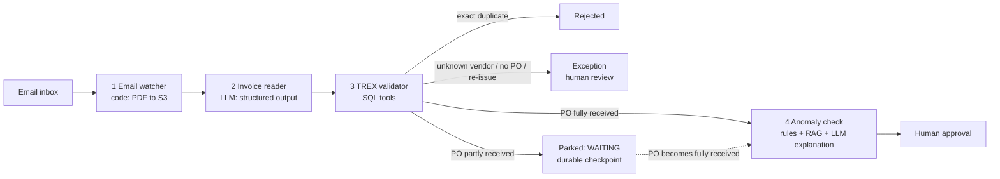
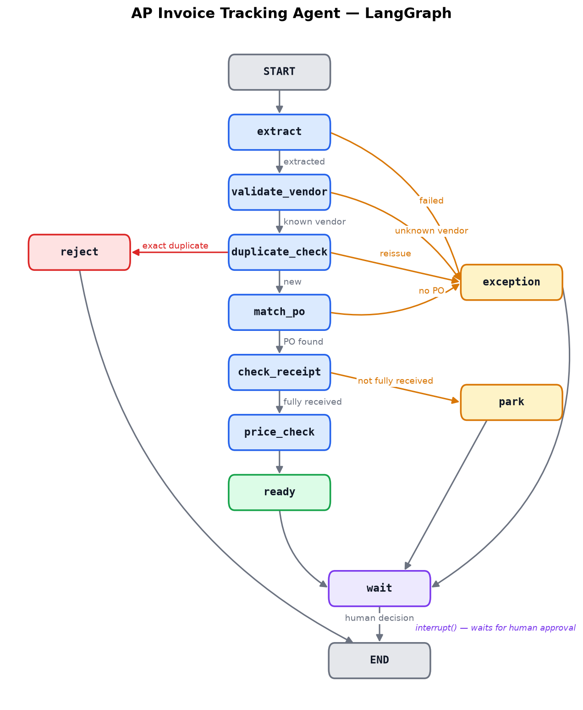

# AP Invoice Tracking Agent

An AI agent that reads supplier invoices from email, checks them against a purchasing system, **parks invoices for partly delivered orders**, and asks a human to approve them the moment receiving is complete.

Built in Python with LangGraph, Pydantic structured outputs, Postgres (Supabase + pgvector), AWS S3 and Streamlit.

> **All data in this repository is synthetic.** The purchasing system ("TREX") is a mock modelled on the kind of procure-to-pay software used in industry. No real vendors, amounts or company code are included.

---

## The problem

In many purchasing systems an invoice **cannot be attached to a purchase order until every line on that PO has been received.**

When a vendor invoices on Nov 5 but two items arrive on Nov 16, the invoice sits in an accounts-payable inbox for eleven days. The clerk then has to find the old email, download it, and attach it by hand, while the payment-terms clock has been running since Nov 5. At around 2,000 invoices a month, with roughly 20% involving partial deliveries, that is hundreds of invoices a month tracked by memory and inbox search, with real risk of late payments and duplicates.

## What the agent does

| Day | Without the agent | With the agent |
| --- | --- | --- |
| Nov 5 | Invoice PDF arrives by email; the system blocks attachment | Agent reads the PDF, matches vendor and PO, sees 2 items missing, **parks** the invoice with its due date |
| Nov 5 to 16 | Invoice sits in an inbox; may be lost or re-sent | Invoice waits in durable state; a resend is recognised as a duplicate |
| Nov 16 | Clerk hunts for the old email | Agent detects the PO is fully received, runs anomaly checks, and puts it in the clerk's approval queue |

## How it works



1. **Email watcher** (plain code). Reads the inbox (Gmail over IMAP, or a folder of `.eml` files), keeps PDF attachments, stores them encrypted in S3 under their SHA-256 hash, and records every email so nothing is processed twice.
2. **Invoice reader** (LLM). Extracts vendor, invoice number, date, PO, line items and totals into a Pydantic model. Validators check the arithmetic; if the numbers do not add up, the error is sent back and the model corrects itself. Scanned PDFs fall back to vision. Dates are returned as printed and parsed in code, with ambiguous `03/11/2026`-style dates flagged.
3. **TREX validator** (SQL tools, no LLM). Matches the vendor (exact, email domain, fuzzy), the PO (number, email-subject hint, or content scoring when no PO is printed), checks for duplicates and re-issues, and reads line-level receiving status.
4. **Anomaly check.** Rules flag price over tolerance, quantities billed above received, lines not on the PO, currency mismatches and future dates. A statistical check and a pgvector similarity search over the vendor's invoice history flag unusual amounts. The LLM only writes a short explanation of the evidence for the clerk.

Each invoice runs in its **own LangGraph thread** (`invoice-<sha256>`), checkpointed to Postgres after every step. A crash mid-run resumes from the last checkpoint without paying for extraction again.



## Design decisions

- **Workflow, not a free-roaming agent.** Accounts payable is a known process and auditors need predictable paths, so the steps run in a fixed order with conditional edges. The LLM is used only where judgement on unstructured input is needed: reading the PDF and explaining anomalies.
- **Rules decide, the LLM explains.** Matching, tolerances and outlier detection are deterministic and tested. Nothing about money is decided by a model.
- **Idempotency at every layer.** Email Message-ID, PDF content hash, extraction cache by hash, and unique constraints on `(vendor, invoice number)` in the database itself.
- **Intake decoupled from processing.** The watcher only queues work; a slow model call never blocks the inbox.
- **Human in the loop.** The agent pauses with `interrupt()` for parked, exception and ready invoices. No payment is ever initiated without a human decision.
- **Separate schemas.** `trex` holds the mock system of record, `agent` holds the agent's own state, and `langgraph` holds checkpoints. Nothing lives in `public`.
- **Privacy and residency.** Synthetic data only; S3 and the database in Canadian regions; embeddings run locally with fastembed, so invoice text is not sent anywhere for vector search.

## Tech stack

| Area | Tools |
| --- | --- |
| Language and tooling | Python 3.12, uv, ruff, pytest |
| LLM | OpenRouter (OpenAI-compatible API), `instructor`, Pydantic v2 |
| Agent orchestration | LangGraph with `PostgresSaver` checkpoints |
| Data | Supabase Postgres, pgvector (HNSW), fastembed (`bge-small-en-v1.5`) |
| Documents | pdfplumber, PyMuPDF, reportlab (synthetic invoices) |
| Cloud | AWS S3 (`ca-central-1`) |
| UI | Streamlit operator workbench |
| AI-assisted development | Claude Code with a project `CLAUDE.md`, plan mode, and reviewed diffs |

## Synthetic dataset

`data_gen` builds a reproducible world from a fixed seed: 25 vendors, 80 purchase orders with line-level receiving, 12 months of vendor invoice history, and **60 invoice PDFs** in three layouts plus scanned copies, each sent as an email. `evals/ground_truth.json` holds the true field values and expected outcome for every invoice across ten scenarios:

clean match · partial delivery that completes later · partial delivery that never completes · exact duplicate · re-issued invoice number · price above PO · amount far above the vendor's normal range · unknown vendor · no PO number · scanned PDF

A receiving simulator (`data_gen.simulate --day`) moves the calendar forward to replay the Nov 5 to Nov 16 story.

## Results

Measured on the synthetic eval set. *(Numbers to be added after the full eval run.)*

| Metric | Result |
| --- | --- |
| Field-level extraction accuracy | _TBD_ |
| Correct agent outcome (status) | _TBD_ |
| Duplicate detection rate | _TBD_ |
| Average cost per invoice | _TBD_ |

## Quickstart

Requires Python 3.12 and [uv](https://docs.astral.sh/uv/), a Supabase (or any Postgres with pgvector) database, an S3 bucket, and an OpenRouter API key.

```bash
git clone https://github.com/simer169/ap-invoice-agent.git
cd ap-invoice-agent
uv sync
cp .env.example .env          # fill in your own keys; never commit .env
uv run python scripts/check_setup.py
uv run python scripts/migrate.py
```

Run the pipeline end to end:

```bash
uv run python -m data_gen.build --seed 42                                    # fake TREX data, PDFs, emails
uv run python -m ap_agent.embeddings --backfill                              # embed vendor history (local model)
uv run python -m ap_agent.mail.watch --source local --path sample_inbox/eml  # intake to S3
uv run python -m ap_agent.extract --pending                                  # LLM extraction (cached)
uv run python -m ap_agent.graph.run --pending                                # validate, park, flag
uv run streamlit run dashboard/app.py                                        # operator workbench
```

Replay the partial-delivery story and inspect a thread:

```bash
uv run python -m data_gen.simulate --day 2026-11-16
uv run python -m ap_agent.graph.run --thread invoice-<sha256>
uv run python -m ap_agent.graph.run --resume invoice-<sha256>
```

Check outcomes against the answer key:

```bash
uv run python -m evals.outcome_check --split dev
```

## Tests

```bash
uv run pytest                    # unit tests (fast, no network)
uv run pytest -m integration     # database tests (needs DATABASE_URL)
uv run pytest -m llm             # live LLM tests (small OpenRouter cost)
uv run ruff check .
```

## Project layout

```text
src/ap_agent/
  mail/        email sources (IMAP, local), S3 storage, watcher
  extract/     PDF reader, normalisation, extraction cache
  tools/       vendor, PO, duplicate, receipt, pricing, terms, anomaly tools
  graph/       LangGraph state, nodes, routing, checkpointer, runner
  embeddings.py, llm.py, models.py, config.py, ui_queries.py
dashboard/     Streamlit workbench (all data access via ui_queries.py)
data_gen/      synthetic data, invoice PDFs, emails, receiving simulator
db/migrations/ numbered SQL migrations (trex, agent, langgraph schemas)
evals/         ground truth and outcome checks
tests/         unit and integration tests
```

## Roadmap

- [x] Mock purchasing database with line-level receiving
- [x] Reproducible synthetic dataset with ground truth
- [x] Email watcher with S3 storage and idempotency
- [x] LLM extraction with structured outputs, self-correction and vision fallback
- [x] LangGraph agent with Postgres checkpoints, parking, exceptions and crash recovery
- [x] Rule-based anomaly detection with pgvector similarity and LLM explanations
- [ ] Poller that resumes parked invoices when POs are fully received, with near-due alerts
- [ ] Approval queue in the UI (approve, reject, hold, resolve exceptions)
- [ ] FastAPI layer and ISO 20022 (pain.001) payment-file hand-off
- [ ] Full eval report: extraction accuracy, outcome accuracy, cost, model comparison
- [ ] Deployment on AWS ECS Fargate with Terraform and GitHub Actions (OIDC)

## About

Built by Simer Singh, a backend developer with eight years of PHP, MySQL and AWS experience in procurement and payment systems, as a portfolio project for AI integration work. The problem comes from first-hand experience with procure-to-pay workflows; the data and system here are entirely synthetic.
